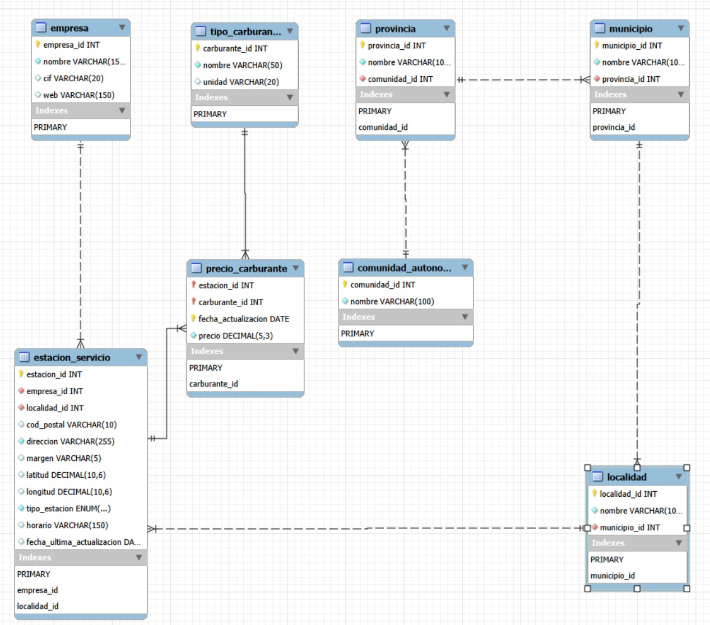

# ⛽ MITER ETL → MySQL

Proceso **ETL en Java** que carga los ficheros públicos de precios de carburantes del Ministerio (MITECO/MITER), tanto de **estaciones terrestres** como **marítimas**, en un **modelo relacional MySQL** normalizado. Después se explota con consultas SQL y se optimiza con índices.

> Proyecto académico de la asignatura *Bases de Datos Avanzadas* (Grado en Ingeniería Informática).

## 🧱 Qué incluye

| Carpeta | Contenido |
|---|---|
| `src/main/java/.../parser` | `ExcelParser`: lectura de los `.xls` oficiales con Apache POI |
| `src/main/java/.../model` | `EstacionServicio`: modelo de dominio |
| `src/main/java/.../loader` | `DataLoader`: transformación y carga, con alta de comunidades, provincias, municipios, localidades, empresas, estaciones y precios |
| `src/main/java/.../db` | `DatabaseManager`: conexión JDBC con MySQL |
| `sql/01_DDL_esquema.sql` | Esquema `miter_bbdd`, generado con MySQL Workbench (8 tablas) |
| `sql/02_consultas.sql` | Consultas de explotación: operadores con más estaciones, precios medios, etc. |
| `sql/03_indices_y_optimizacion.sql` | Índices adicionales y análisis de su impacto en las consultas |
| `modelo/` | Diagrama entidad-relación y modelo `.mwb` |

## 🗂️ Modelo de datos

`comunidad_autonoma → provincia → municipio → localidad → estacion_servicio ← empresa`, más `tipo_carburante` y `precio_carburante`. La clave primaria compuesta de esta última es *estación, carburante y fecha de actualización*.



## ▶️ Ejecución

1. Crear el esquema con `sql/01_DDL_esquema.sql`.
2. Descargar los ficheros de precios del Geoportal de Gasolineras del Ministerio y colocarlos en `src/main/resources/` como `preciosEESS_es.xls` y `embarcacionesPrecios_es.xls`. No se incluyen en el repositorio.
3. Definir las credenciales como variables de entorno:
   ```bash
   export MITER_DB_USER=miter
   export MITER_DB_PASSWORD=********
   ```
4. Compilar y ejecutar `es.carlosgr.miter.Main` desde el IDE o con Maven (`mvn clean compile`).

## 🛠️ Tecnologías

Java 11 · Maven · Apache POI · JDBC · MySQL 8 · MySQL Workbench

---
👤 Carlos Gálvez Reguera
